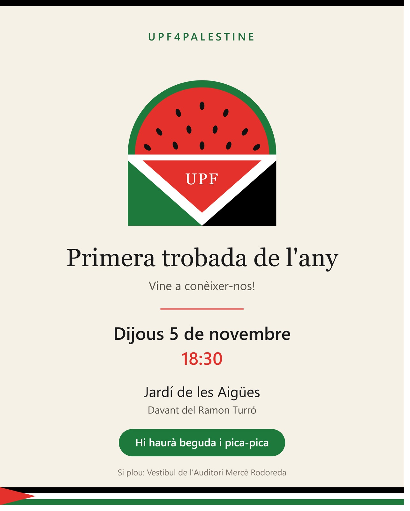
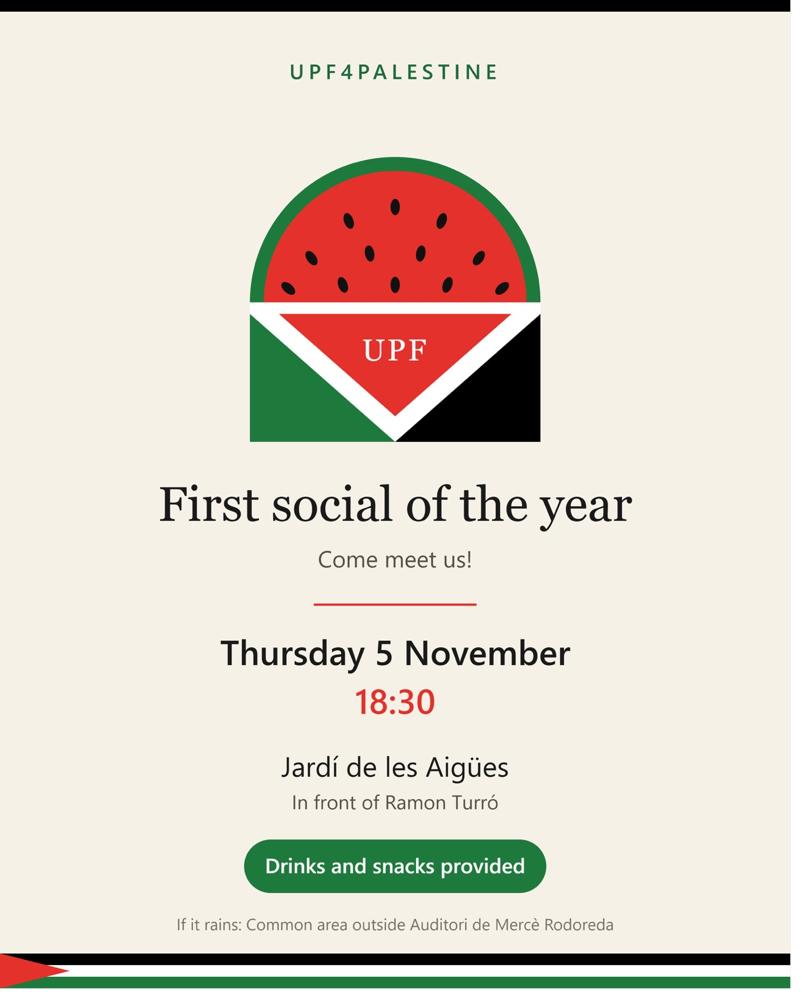

Join UPF4Palestine for our first social event of the year on November 5th at 18h30 in the Jardì de los Agües in front of Ramon Turró (or the common area outside Auditori de Mercè Rodoreda in case of bad weather)! We are a group of UPF students and faculty, who organise events around Palestine, engage with the administration to make sure it keeps its commitments against institutional collaboration with Israel, and offer a space to get together with other members of the UPF community who care about Palestine. Come and meet us! Drinks and snacks will be provided.

**5 de novembre de 2026, 18:30**

**Jardì de les Agües** 
**Campus de la Ciutadella**
**Univesitat Pompeu Fabra** 

